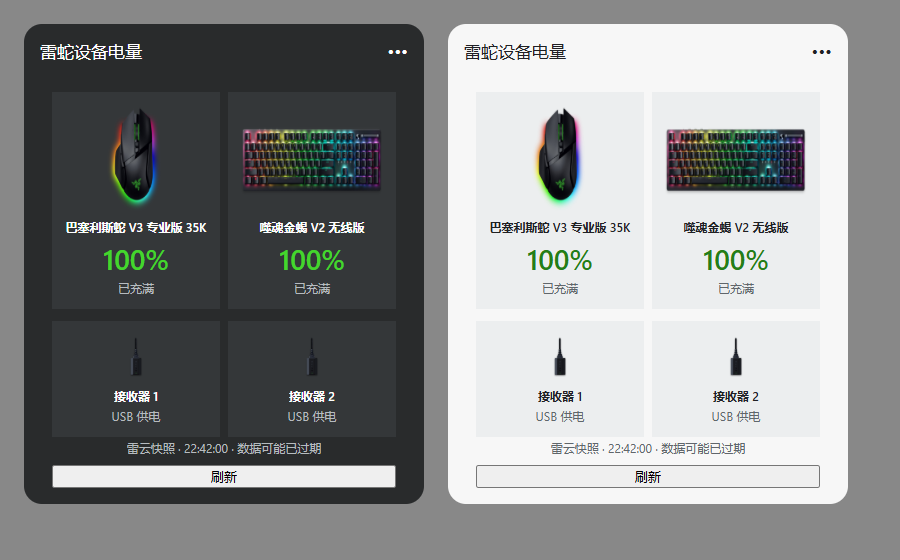

# Razer Battery Widget

Windows 11 **Win+W 小组件**，在同一张卡片中查看雷蛇设备电量。当前版本：**1.1.3**。

这是我闲着没事做着玩的个人小项目，目前够自己用就行。没有经过大量测试，主要只在自己的电脑和设备上试过，换一台电脑、换个设备或雷云版本，可能就会遇到问题。有兴趣可以拿去折腾，稳定性和兼容性暂时没有保证。



预览使用 Adaptive Cards 浏览器渲染；Windows 面板的字体和间距可能略有差异。

## 功能

- 从本机 Razer Synapse 4 日志读取设备列表、电量和充电状态。
- 鼠标、键盘使用双列图文卡片；分别列出 HyperPolling 接收器并显示 USB 供电。
- 图片内置，运行时不需要联网加载图片，也不上传设备信息。
- 使用面板的语义颜色，适配深色与浅色主题。
- 提供中、大两种尺寸；大尺寸额外显示充电状态。
- 面板激活期间每 15 秒读取一次，支持手动刷新。
- 标题电池图标使用透明背景；双击设备卡片区域打开本机雷云，单击不启动。通过连续两次卡片点击识别，间隔使用 Windows 双击速度设置。
- 显示雷云快照时间，超过 5 分钟提示数据可能过期。

读取周期不等于设备上报周期：如果雷云尚未写入新快照，手动或定时刷新仍会显示上一条数据。

## 环境要求

- Windows 11 x64，版本 22H2 或更新。
- Windows Web Experience Pack 与可用的 Win+W 小组件面板。
- 当前用户运行 Razer Synapse 4，并已产生设备快照日志。
- 编译需要 .NET 8 SDK 或可编译 .NET 8 项目的更新 SDK，以及 NuGet 访问能力。

已在本机验证：Basilisk V3 Pro 35K、DeathStalker V2 Pro、两个 HyperPolling 接收器。其他雷云快照中的设备会列出名称和电量；只有上述型号内置专用实物图。

## 编译与安装

```powershell
./Build.ps1
```

生成 `RazerBatteryWidget.msix`。此包默认**未签名**，不能直接安装；需要使用与 `AppxManifest.xml` 发布者 `CN=LocalRazerWidget` 匹配的代码签名证书签名。

如果当前用户证书存储中已有匹配的签名证书：

```powershell
./Build.ps1 -SigningThumbprint YOUR_CERTIFICATE_THUMBPRINT
```

该选项同时导出对应公钥证书为 `RazerBatteryWidget.cer`。私钥不会导出。随后运行：

```powershell
./Install.ps1
```

安装脚本需要管理员确认，会将公钥证书导入本地计算机的“受信任人”存储，再安装 MSIX。源码仓库不包含签名证书、私钥或预编译安装包。不同电脑需要自行准备签名证书，或使用可信发布者签名的安装包。

安装完成后，按 **Win+W → 添加小组件 → 雷蛇设备电量 → 固定**，建议选择大尺寸。

卸载可通过 **Windows 设置 → 应用 → 已安装的应用 → 雷蛇设备电量** 完成。

## 数据来源与限制

读取路径：`%LOCALAPPDATA%\Razer\RazerAppEngine\User Data\Logs\` 下的 `systray_systrayv*.log` 与 `dashboard*.log`。

读取 `devices:`、`connectingDeviceData:`、`Device` 和面板设备列表，按日志内容的时间选择最新完整快照，不依赖文件修改时间。这样可读取开机后补充的鼠标及电量，避免日志轮转造成旧快照覆盖新数据。未变化的日志使用内存解析缓存。设备清单来自雷云快照，并非历史配对设备清单；不合并旧列表，以免已断开的设备重新出现。使用 Windows 配置管理器核对当前连接的 `VID_1532&PID_00B3` 接收器数量，补充雷云合并的同型号接收器。

本程序不向 USB 设备发送命令，也不强制雷云更新快照。雷云日志格式改变后可能需要更新解析逻辑。

## 项目结构

- `src/BatteryReader.cs`：日志读取、快照选择与 USB 接收器枚举。
- `src/Program.cs`：Adaptive Card 布局和 COM provider。
- `tests/`：开机不完整列表、日志轮转、截断写入与断开设备的回归检查，可运行 `dotnet run --project tests/ReaderChecks.csproj`；加 `-- --live` 可检查本机读取结果。
- `AppxManifest.xml`：MSIX 身份及 Windows 小组件注册。
- `DeviceAssets/`：内置设备图片与来源。
- `Build.ps1`：编译、打包及可选签名。
- `Install.ps1`：本地签名证书信任及安装。

## 图片与商标

设备图片来自 Razer Synapse 官方静态资源，来源见 [DeviceAssets/sources.txt](DeviceAssets/sources.txt)。图片仅做格式转换与显示尺寸缩放，其权利归原权利人所有。Razer 及产品名称是相应权利人的商标。本项目为个人制作，未获 Razer 官方背书。

Windows 小组件实现参考：[Microsoft 官方文档](https://learn.microsoft.com/windows/apps/develop/widgets/implement-widget-provider-cs)。
